# React Portfolio Template

A clean, modern developer portfolio built with React. Edit one content file, swap your photo, and deploy to Vercel for free.

**[Live demo](https://portfolio-demo-gum.vercel.app)** · **[Get the template](https://wafabenmiloud.gumroad.com/l/portfolio)**

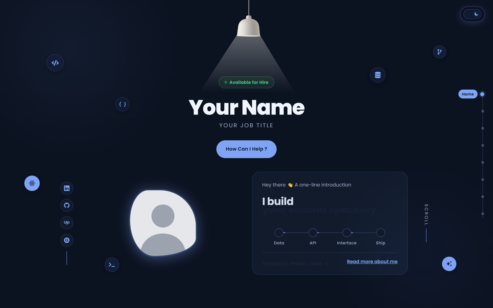

> **This repository is the preview and documentation.** The source code is included with the template, available on [Gumroad](https://wafabenmiloud.gumroad.com/l/portfolio).

## Who it's for

Developers, students and bootcamp grads who want a polished portfolio without designing one from scratch. You should be comfortable running `npm install` and editing a JavaScript file. No design skills needed.

## Features

- **Dark and light mode** with a toggle in the corner
- **Projects gallery** with category filters
- **A case-study page for each project**: overview, problem, solution, features, screenshots, challenges and tech stack
- **Interactive "ask me" section**: visitors pick a question and get an answer that points to your projects
- **Skills carousel**, services, testimonials, news and contact sections
- **Fully responsive**: phone, tablet and desktop
- **Colours and fonts in CSS variables**, so a rebrand is a few lines
- **Step-by-step README** covering install, customisation and deployment

## Screenshots

### Light and dark

| Light | Dark |
| --- | --- |
| 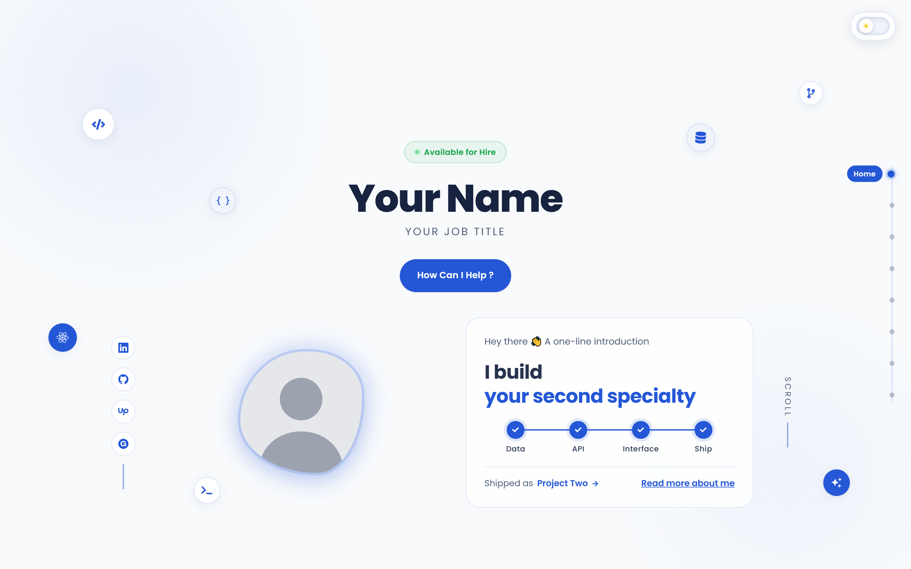 |  |
| 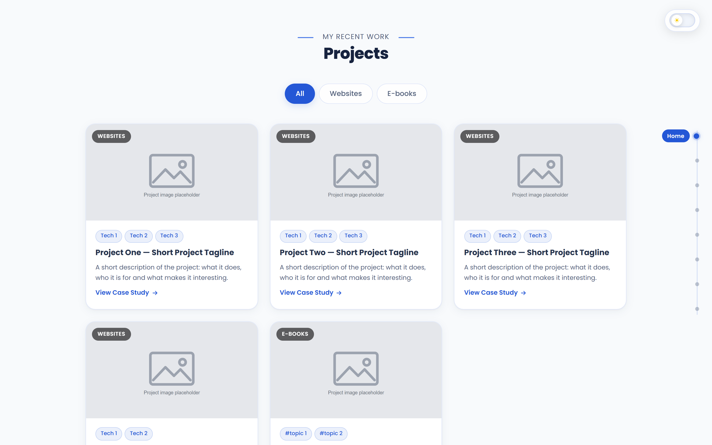 | 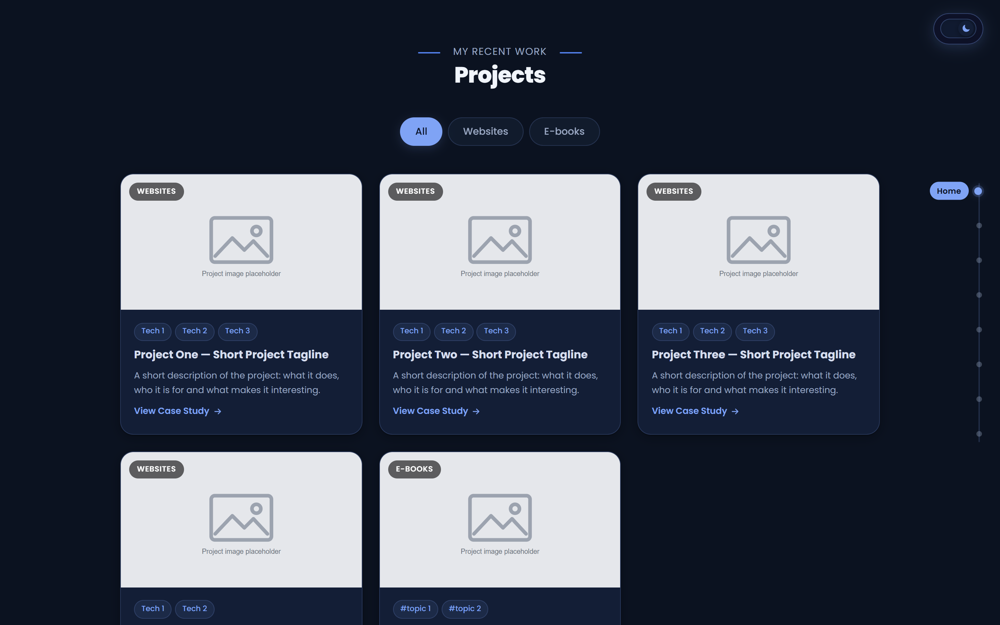 |
| 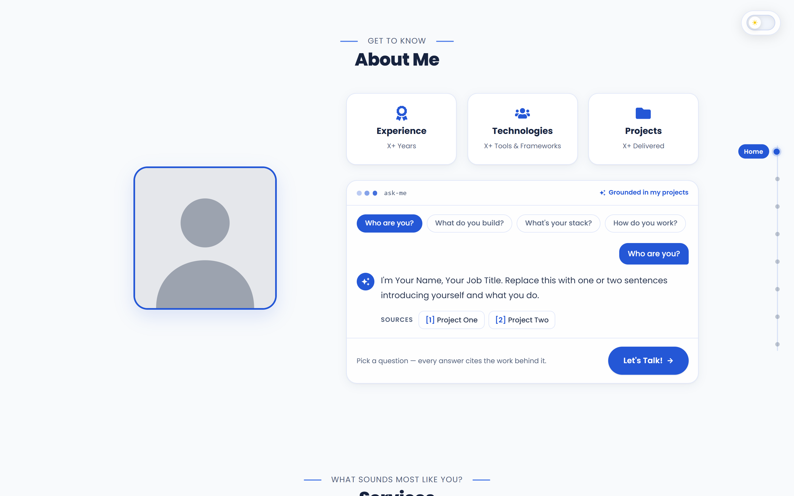 | 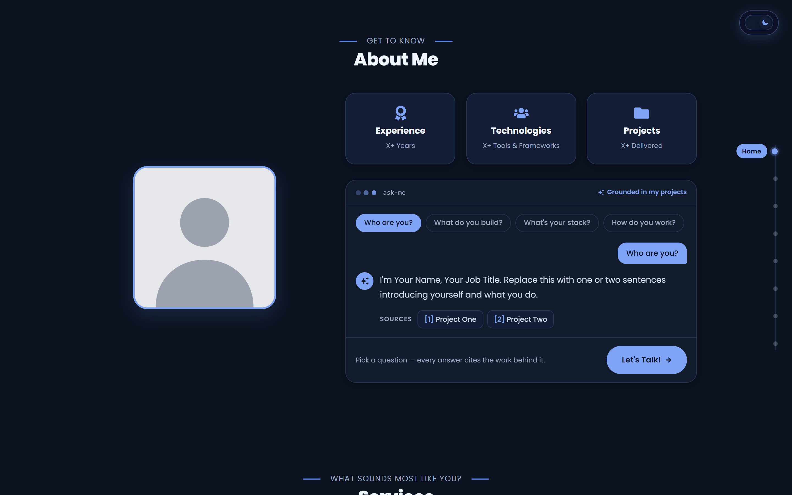 |

### Sections

| Services | Skills carousel |
| --- | --- |
| 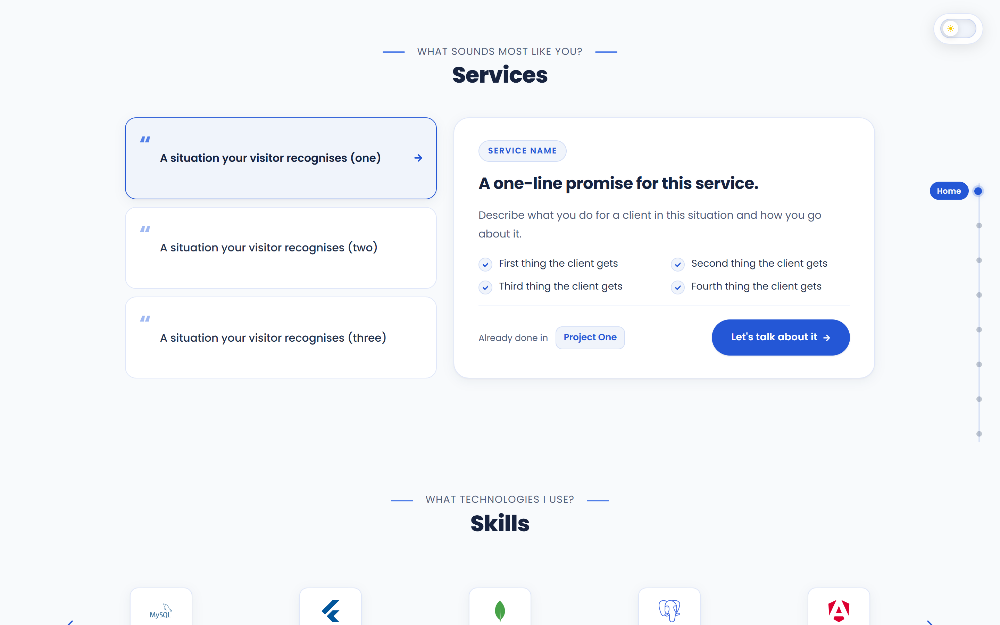 | 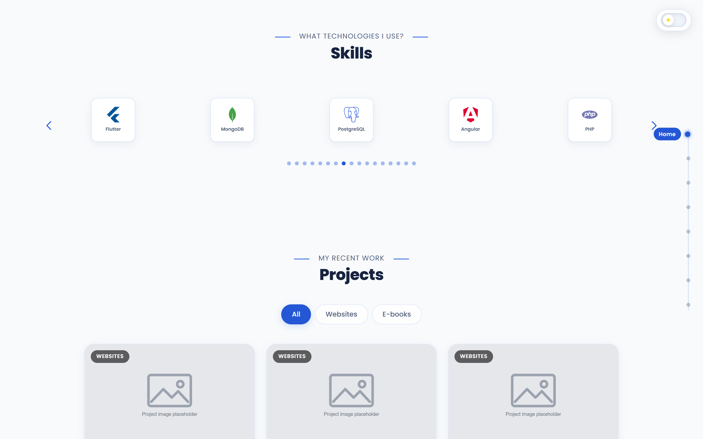 |

| Testimonials | News |
| --- | --- |
| 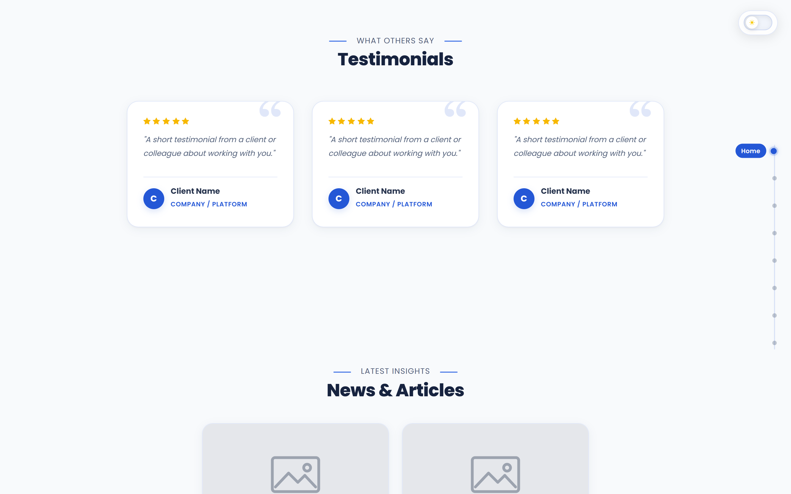 | 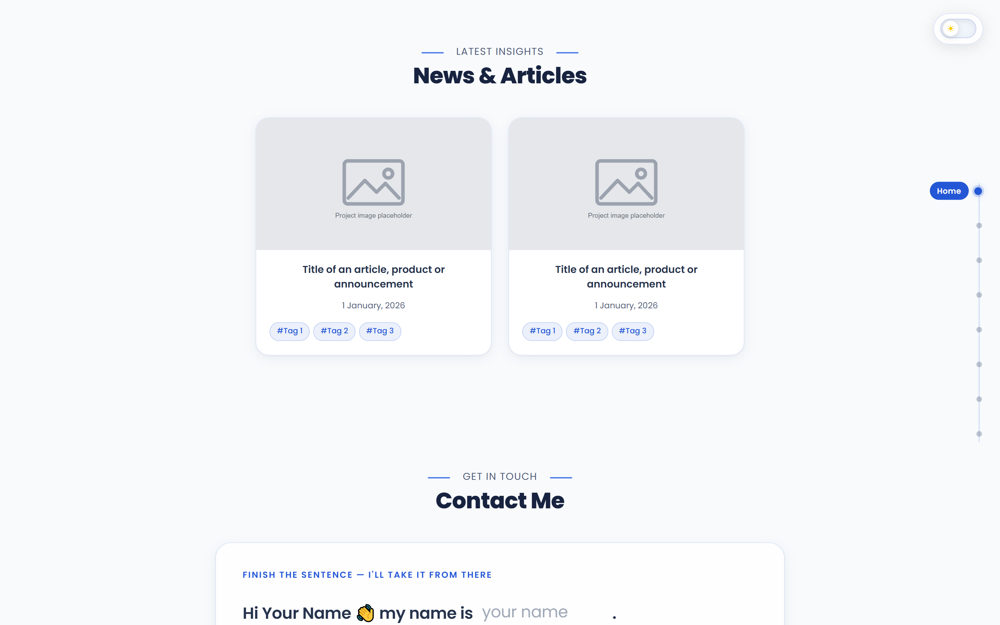 |

| Contact |
| --- |
| 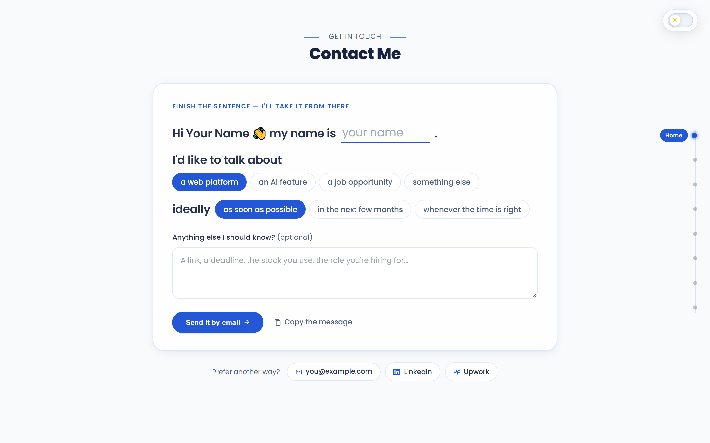 |

### Case-study page

| Top of the page | Numbered sections |
| --- | --- |
| 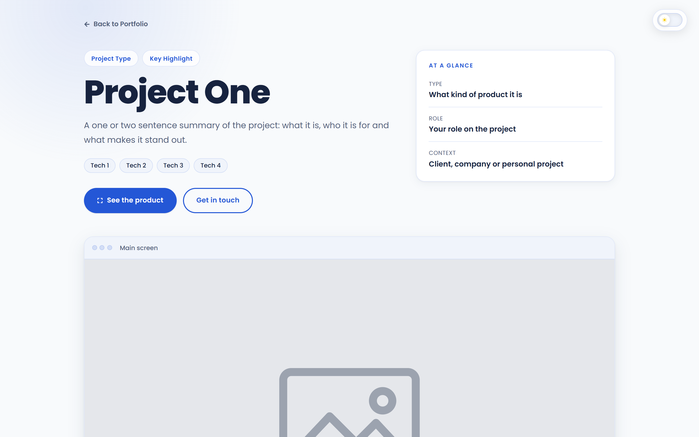 | 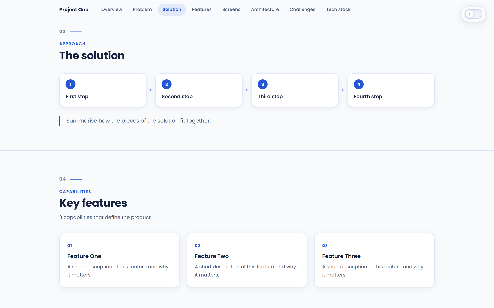 |

### Phone and tablet

  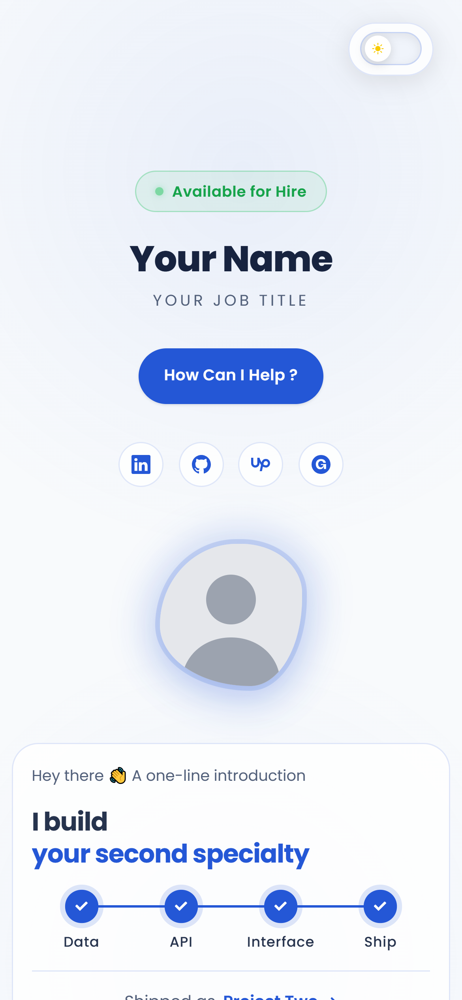
  &nbsp;&nbsp;
  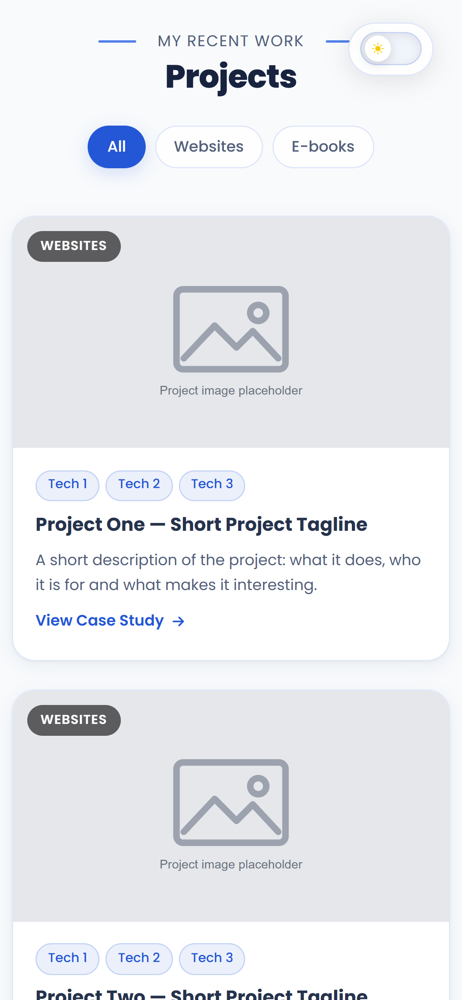
  &nbsp;&nbsp;
  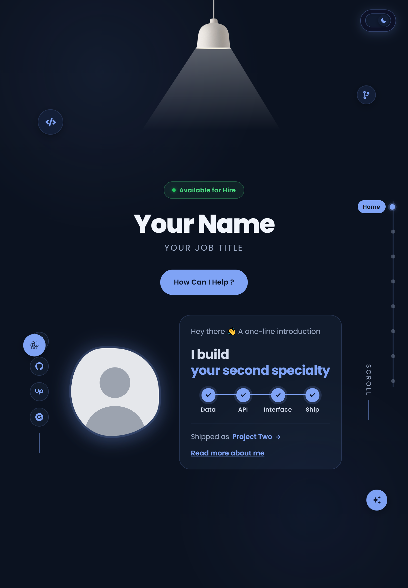

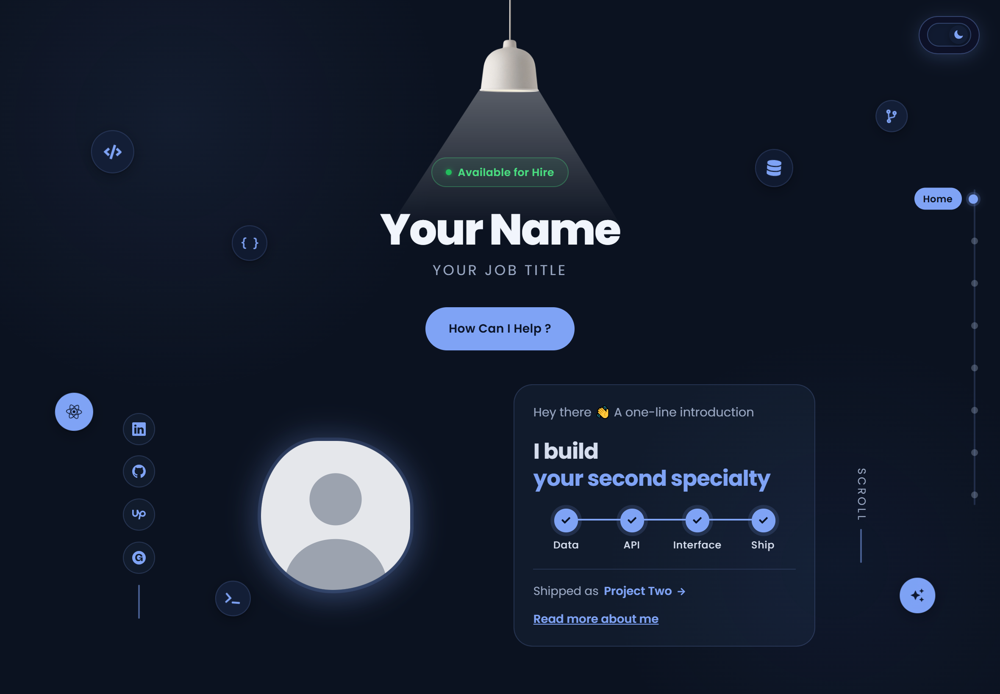

The demo ships with placeholder content ("Your Name", "Project One") so you can see exactly what you will replace.

## How it works

1. Download and unzip the template
2. Run `npm install`, then `npm start`
3. Put your projects, links and testimonials in `src/data.js`, and your name and bio in the Header and About components
4. Replace the profile photo
5. Push to GitHub and import the repository into Vercel (the free tier is enough)

Setup takes about an hour if you already have Node.js installed.

## Tech

React 18 (Create React App) · React Router · Framer Motion · Swiper · React Icons · plain CSS with variables · no backend

## Good to know

- The contact section opens the visitor's email app with your address filled in. There is no server or form backend.
- You need Node.js 18 or newer and a code editor.
- A domain name is not included; the free Vercel URL works out of the box.

## Licence

Buy once, use it for your own portfolio as many times as you like. Please don't resell or redistribute the template itself.

## Questions

Email [wafabenmiloud@gmail.com](mailto:wafabenmiloud@gmail.com). I reply within 24 hours.

---

**[Get the template on Gumroad](https://wafabenmiloud.gumroad.com/l/portfolio)**
